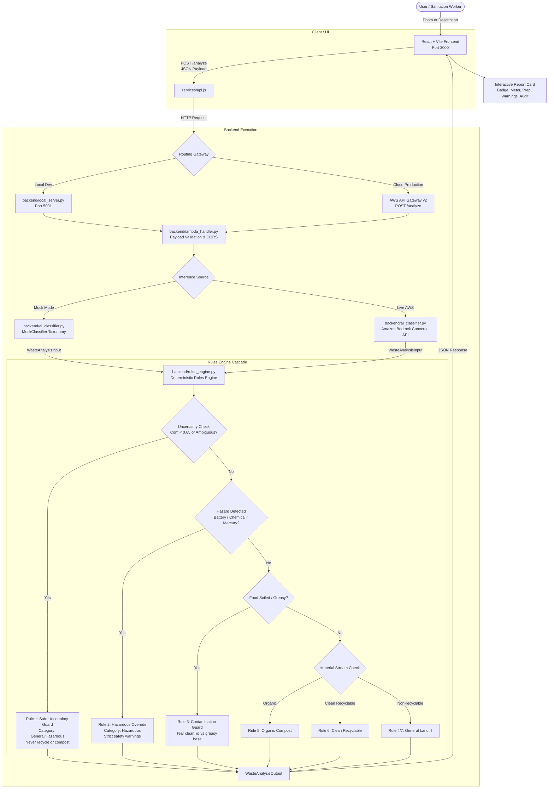

# 🌿 EcoSort AI — AI Waste Segregation Advisor

> **Environmental Hacks Hackathon Project**  
> An intelligent, safety-first waste segregation advisor combining multimodal AI classification (Amazon Bedrock) with a deterministic, local-rules engine to eliminate recycling contamination and neutralize hazardous waste risks.

---

## 📌 Table of Contents
1. [Overview & Motivation](#-overview--motivation)
2. [Key Features](#-key-features)
3. [Technology Stack](#-technology-stack)
4. [System Architecture & Request Flow](#-system-architecture--request-flow)
5. [Project Structure](#-project-structure)
6. [Prerequisites & Installation](#-prerequisites--installation)
7. [Running Locally](#-running-locally)
8. [Testing & Frontend Build](#-testing--frontend-build)
9. [API Documentation (`POST /analyze`)](#-api-documentation-post-analyze)
10. [AI Classification & Deterministic Rules Engine](#-ai-classification--deterministic-rules-engine)
11. [Mock Mode vs. Amazon Bedrock Inference](#-mock-mode-vs-amazon-bedrock-inference)
12. [Current Limitations & Future Roadmap](#-current-limitations--future-roadmap)
13. [AWS Deployment Guide](#-aws-deployment-guide)
14. [Safety Disclaimer](#-safety-disclaimer)

---

## 🌍 Overview & Motivation

### The Problem
Municipal recycling and composting facilities face two major crises:
1. **"Wishcycling" & Contamination**: Well-intentioned consumers toss questionable items into the blue or green bins (e.g., greasy pizza boxes, broken ceramics, metallized chip packets, styrofoam). Contaminated paper and plastic loads frequently cause entire truckloads or processing batches to be rejected and diverted to landfills.
2. **Hazardous & Flammable Waste Hazards**: Spent lithium-ion batteries and pressurized aerosol cans crushed in curbside collection trucks or sorting facilities cause catastrophic fires. Fluorescent light bulbs (CFLs) containing neurotoxic mercury, toxic paints, motor oils, and bio-medical sharps pose severe exposure hazards to sanitation workers and contaminate local groundwater.

### The Solution: EcoSort AI
**EcoSort AI** bridges the gap between consumer uncertainty and strict waste management standards. By decoupling visual/textual identification from a **deterministic safety rules engine**, the application:
- Accurately classifies items into four distinct streams: **Recyclable**, **Organic**, **Hazardous**, and **General**.
- Enforces strict **Uncertainty Guardrails**: ambiguous or unverified items are **never forced into recyclable or organic bins**.
- Applies **Hazardous Overrides**: dangerous items (batteries, mercury bulbs, chemical containers) are always routed to designated Household Hazardous Waste (HHW) depots, overriding any accidental claim of "clean" or "reusable".
- Provides step-by-step preparation steps (e.g., taping battery terminals, partitioning clean pizza box lids from greasy bases, rinsing containers).

---

## ✨ Key Features

- **Dual-Modal Input**: Accept plain-text descriptions or upload waste photos (drag-and-drop or file picker; JPEG, PNG, WEBP, GIF up to 5 MB).
- **Four-Stream Segregation**:
  - 🟦 **Recyclable Stream**: Clean metals, rigid bottles (#1 PET, #2 HDPE, #5 PP), clean paper, and cardboard.
  - 🟩 **Organic Compost**: Biodegradable food scraps, coffee grounds, and garden waste.
  - 🟧 **Hazardous Waste**: Lithium/alkaline batteries, e-waste, fluorescent tubes (mercury), motor oil, paint, chemicals, and sharps.
  - ⬛ **General Waste**: Non-recyclable plastics (#6 styrofoam, metallized pouches, broken ceramics, dirty diapers).
- **Contamination Guard**: Automatically detects food-soiled packaging (e.g. greasy pizza boxes) and instructs users to separate clean lids for recycling while routing greasy bases to compost or landfill.
- **Deterministic Rules Engine**: Independent Python domain logic evaluates AI attributes against environmental regulations, ensuring safety-critical overrides can never be bypassed by LLM hallucinations.
- **Zero-AWS Mock Mode**: Fully functional local offline mode with a rich waste taxonomy for seamless testing and judging without AWS credentials or cloud bills.
- **Transparent Inference Badges**: UI clearly labels whether an analysis was performed via **Local Mock Mode Simulation** or live **Amazon Bedrock Multimodal AI**.
- **1-Click Hackathon Presets**: Instant evaluation buttons (soda can, banana peel, lithium battery, greasy pizza box, CFL bulb, mystery powder) for rapid judging.
- **Rules Engine Audit Trail**: Collapsible inspection drawer showing every sub-rule evaluated for complete algorithmic transparency.

---

## 🛠️ Technology Stack

| Layer | Technologies | Role |
| :--- | :--- | :--- |
| **Frontend** | React 18, Vite 6, Tailwind CSS 3, Lucide React | Clean, responsive, eco-themed user interface |
| **Backend API** | Python 3.12, AWS Lambda, Python `http.server` | Serverless handler + zero-dependency local HTTP server |
| **AI Inference** | Amazon Bedrock (Converse API / Claude 3 Haiku / Nova Lite) | Multimodal visual and natural language understanding |
| **Rules Engine** | Pure Python 3 (Deterministic Domain Logic) | Environmental compliance, uncertainty guardrails, safety overrides |
| **API Gateway** | AWS API Gateway (HTTP API v2) | CORS preflight handling and routing for `POST /analyze` |
| **Infrastructure / IaC** | AWS SAM (Serverless Application Model), CloudFormation, IAM | Automated serverless provisioning and deployment |
| **Testing** | Pytest 9 | Unit and integration test coverage across all rules and API contracts |

---

## 🏗️ System Architecture & Request Flow



---

## 📁 Project Structure

```
ai-waste-segregation-advisor/
├── backend/
│   ├── __init__.py               # Python package initialization
│   ├── ai_classifier.py          # Amazon Bedrock integration & MockClassifier
│   ├── rules_engine.py           # Deterministic environmental & safety rules engine
│   ├── lambda_handler.py         # AWS Lambda entrypoint for POST /analyze + CORS
│   ├── local_server.py           # Zero-dependency local development server (Port 5001)
│   ├── requirements.txt          # Python dependencies (boto3, pytest)
│   └── tests/
│       ├── __init__.py           # Test package initialization
│       ├── test_rules_engine.py  # Unit tests for rules engine, overrides & contamination
│       ├── test_ai_classifier.py # Unit tests for mock classifier & fallback handling
│       └── test_lambda_handler.py# Integration tests for Lambda API contract & validation
├── frontend/
│   ├── index.html                # HTML single page entrypoint
│   ├── package.json              # Node dependencies (React 18, Vite 6, Tailwind, Lucide)
│   ├── vite.config.js            # Vite configuration (Port 3000)
│   ├── tailwind.config.js        # Eco-color palette configuration
│   ├── postcss.config.js         # PostCSS configuration
│   ├── .env.example              # Frontend environment variables template
│   ├── src/
│   │   ├── main.jsx              # React DOM mounting root
│   │   ├── App.jsx               # Main state orchestration, error alerts, stats
│   │   ├── index.css             # Tailwind base styles and scanner animations
│   │   ├── components/
│   │   │   ├── Header.jsx        # Branding, active engine pill, guide modal trigger
│   │   │   ├── WasteInputForm.jsx# Dual text & photo input with drag-and-drop
│   │   │   ├── AnalysisResult.jsx# Structured result report & engine source banner
│   │   │   ├── CategoryBadge.jsx # Color-coded badges for 4 streams + uncertainty
│   │   │   ├── SafetyAlert.jsx   # Critical hazard warning callout
│   │   │   ├── QuickPresets.jsx  # 1-click test preset buttons
│   │   │   ├── CategoryGuideModal.jsx # Educational 4-stream guidelines modal
│   │   │   └── EnvironmentalStats.jsx # Real-time session diversion counter
│   │   └── services/
│   │       ├── api.js            # Fetch client for POST /analyze with error handling
│   │       └── mockData.js       # Curated presets & test cases
│   └── public/                   # Static public assets
├── deployment/
│   ├── template.yaml             # AWS SAM template (Lambda + HTTP API Gateway)
│   ├── deploy-aws.sh             # Automated/guided AWS deployment script
│   └── iam-policy.json           # Least-privilege IAM policy for Bedrock & Logs
├── .gitignore                    # Git ignore file for Python, Node, and AWS artifacts
└── README.md                     # Comprehensive project documentation
```

---

## 💻 Prerequisites & Installation

### System Requirements
- **Python**: Version 3.10 or higher (Python 3.12 recommended).
- **Node.js**: Version 18.0 or higher (Node 20+ recommended).
- **npm**: Version 9.0 or higher.
- *(Optional for Cloud Deployment)*: AWS CLI v2 and AWS SAM CLI.

### 1. Clone & Set Up the Repository
```bash
git clone https://github.com/<your-username>/ai-waste-segregation-advisor.git
cd ai-waste-segregation-advisor
```

### 2. Set Up the Python Backend Virtual Environment
```bash
# Create a virtual environment
python3 -m venv .venv

# Activate the virtual environment
source .venv/bin/activate  # On Windows: .venv\Scripts\activate

# Install backend dependencies
pip install -r backend/requirements.txt
```

### 3. Install Frontend Dependencies
```bash
cd frontend
npm install
cd ..
```

---

## 🚀 Running Locally

The local setup runs entirely on your machine **without requiring AWS credentials or an internet connection to AWS**.

### Step 1: Start the Backend Local API Server
In your first terminal:
```bash
cd /home/mufeed/ai-waste-segregation-advisor
source .venv/bin/activate

# Start the local development server (runs with mock mode by default)
python -m backend.local_server
```
The server starts on `http://localhost:5001`.
You can verify it in another terminal:
```bash
curl http://localhost:5001/health
```
*Expected response:*
```json
{
  "status": "healthy",
  "service": "AI Waste Segregation Advisor Local API",
  "endpoints": ["POST /analyze", "GET /health"],
  "mock_mode": "true"
}
```

### Step 2: Start the Frontend React Application
In your second terminal:
```bash
cd /home/mufeed/ai-waste-segregation-advisor/frontend
npm run dev
```
Open your browser at **`http://localhost:3000`**.

---

## 🧪 Testing & Frontend Build

### Running Backend Tests
The backend test suite contains **27 comprehensive tests** covering rules engine evaluation, hazardous overrides, contamination prevention, uncertainty guardrails, payload validation, and API Gateway contract compliance:

```bash
cd /home/mufeed/ai-waste-segregation-advisor
source .venv/bin/activate

pytest backend/tests/ -v
```

#### Test Suite Summary:
- **`test_rules_engine.py`**: Clean recyclables, organic scraps, hazardous overrides (batteries, chemicals, mercury), greasy pizza box partitioning, low-confidence uncertainty triggers, and styrofoam diversion.
- **`test_ai_classifier.py`**: Mock taxonomy lookups, gibberish handling, image-only mock safe uncertainty, text+image classification, and Bedrock client fallback.
- **`test_lambda_handler.py`**: CORS preflight `OPTIONS`, valid text submissions, image-only submissions, text+image submissions, empty payloads, malformed JSON, zero-byte images, corrupt base64, unsupported MIME types (e.g. PDF), oversized payloads (> 5 MB), and hazardous warnings.

### Building the Frontend for Production
```bash
cd /home/mufeed/ai-waste-segregation-advisor/frontend
npm run build
```
Vite bundles the production assets into `frontend/dist/`.

---

## 📡 API Documentation (`POST /analyze`)

The backend exposes a single, consistent endpoint for waste segregation analysis.

- **URL**: `/analyze`
- **Method**: `POST`
- **Content-Type**: `application/json`

### Request Headers
```http
POST /analyze HTTP/1.1
Host: localhost:5001
Content-Type: application/json
```

### Request Parameters

| Field | Type | Required | Description |
| :--- | :--- | :--- | :--- |
| `text` | `string` | Optional* | Plain-text description of the waste item (e.g., *"clean aluminum can"*). |
| `image` | `string` | Optional* | Base64-encoded image or Data URI (e.g., `data:image/jpeg;base64,...`). Supported formats: JPEG, PNG, WEBP, GIF. Max 5 MB. |
| `mock` | `boolean`| Optional | Explicitly forces deterministic mock mode (`true` or `false`). Defaults to `false`. |

*\* At least one of `text` or `image` must be provided.*

---

### Sample Requests & Responses

#### 1. Clean Recyclable Item (Text)
**Request:**
```bash
curl -X POST http://localhost:5001/analyze \
  -H "Content-Type: application/json" \
  -d '{"text": "Clean aluminum soda can", "mock": true}'
```

**Response (`200 OK`):**
```json
{
  "status": "success",
  "item_name": "Aluminum Beverage Can",
  "category": "recyclable",
  "is_uncertain": false,
  "confidence": 0.96,
  "confidence_level": "high",
  "summary": "'Aluminum Beverage Can' is a recyclable commodity. Proper preparation ensures high recovery rates.",
  "material": "Aluminum metal (#41 ALU)",
  "disposal_instructions": [
    "Empty all liquids completely.",
    "Rinse lightly to remove sticky residue.",
    "Place in your standard blue recycling bin (no need to crush unless saving space)."
  ],
  "safety_warnings": [],
  "preparation_steps": [
    "Empty contents completely",
    "Quick rinse"
  ],
  "alternative_options": [
    "Redeem at local container deposit depot for cash refund where available."
  ],
  "environmental_impact": "Recycling reduces virgin extraction of bauxite, petroleum, and timber while cutting industrial greenhouse gas emissions by up to 95%.",
  "rules_applied": [
    "Rule 6 [Clean Recyclable Rule]: Valid dry recyclable material verified.",
    "Sub-rule [Metal Recyclable]: Highly infinitely recyclable."
  ],
  "source": "mock",
  "ai_explanation": "Clean aluminum beverage container with high recovery value."
}
```

---

#### 2. Hazardous Battery (Safety Override)
**Request:**
```bash
curl -X POST http://localhost:5001/analyze \
  -H "Content-Type: application/json" \
  -d '{"text": "smartphone lithium battery", "mock": true}'
```

**Response (`200 OK`):**
```json
{
  "status": "success",
  "item_name": "Lithium-Ion / Dry-Cell Battery",
  "category": "hazardous",
  "is_uncertain": false,
  "confidence": 0.95,
  "confidence_level": "high",
  "summary": "'Lithium-Ion / Dry-Cell Battery' contains hazardous or regulated constituents requiring specialized disposal.",
  "material": "Heavy metals, lithium, alkaline electrolyte",
  "disposal_instructions": [
    "Tape both terminals (+ and -) with clear packing tape or electrical tape.",
    "Place each battery into a separate plastic bag.",
    "Drop off at a certified battery recycling depot, Home Depot, Best Buy, or Call2Recycle drop box."
  ],
  "safety_warnings": [
    "DANGER / HAZARD: Do not place in curbside trash or curbside recycling.",
    "Never incinerate, crush, or pour down plumbing or storm drains.",
    "FIRE HAZARD: Lithium-ion and metal batteries can spark or experience thermal runaway if crushed."
  ],
  "preparation_steps": [
    "Insulate terminals with non-conductive tape"
  ],
  "alternative_options": [
    "Call2Recycle partner locator: find nearest drop-off box."
  ],
  "environmental_impact": "Prevents toxic heavy metals, corrosives, and flammable chemicals from leaching into groundwater and soils.",
  "rules_applied": [
    "Rule 2 [Hazardous Safety Override]: Hazardous item or constituent detected.",
    "Sub-rule [Battery Safety]: Terminal insulation and fire prevention required."
  ],
  "source": "mock",
  "ai_explanation": "Identified as a portable chemical battery containing hazardous and reactive heavy metals."
}
```

---

#### 3. Uploaded Image in Mock Mode (Honest Uncertainty Guard)
When an image is submitted without a descriptive text string in Mock Mode:

**Request:**
```bash
curl -X POST http://localhost:5001/analyze \
  -H "Content-Type: application/json" \
  -d '{"image": "data:image/jpeg;base64,/9j/4AAQ...", "mock": true}'
```

**Response (`200 OK`):**
```json
{
  "status": "success",
  "item_name": "Unverified Waste Item (Image Only)",
  "category": "general",
  "is_uncertain": true,
  "confidence": 0.35,
  "confidence_level": "low",
  "summary": "The item 'Unverified Waste Item (Image Only)' could not be definitively identified with high confidence (35%). To prevent contaminating recycling streams or compost batches, safe non-hazardous disposal is advised.",
  "material": "Unidentified from Image",
  "disposal_instructions": [
    "If the item is ordinary non-chemical household scrap, place it in the general/landfill bin.",
    "If there is any chance it contains batteries, wiring, or chemicals, treat it as hazardous waste.",
    "Check for manufacturer recycling codes (e.g. resin identification triangle) before disposal."
  ],
  "safety_warnings": [
    "Uncertain identification: Placing unknown materials in recycling can contaminate entire processing batches (wishcycling).",
    "Do not incinerate or flush unknown items."
  ],
  "preparation_steps": [
    "Isolate from clean recyclables and food compost",
    "Inspect for manufacturer labels or hazard symbols"
  ],
  "alternative_options": [
    "Use your local city council waste search tool or app to look up specific localized regulations."
  ],
  "environmental_impact": "Preventing recycling contamination saves clean batches from being diverted to landfills.",
  "rules_applied": [
    "Rule 1 [Uncertainty Guard]: Confidence (0.35) below threshold (0.65) or input ambiguous.",
    "Sub-rule: Excluded from recyclable and compostable streams to prevent batch contamination."
  ],
  "source": "mock",
  "ai_explanation": "In mock mode, image pixels cannot be visually analyzed locally. Real computer vision inference requires Amazon Bedrock (multimodal Claude 3 or Nova). For local mock testing, provide a text description alongside the photo or test with 1-click presets. Safe uncertainty protocols applied."
}
```

---

#### 4. Validation Error (e.g., Unsupported MIME Type)
**Request:**
```bash
curl -X POST http://localhost:5001/analyze \
  -H "Content-Type: application/json" \
  -d '{"image": "data:application/pdf;base64,JVBERi0xLjQK"}'
```

**Response (`400 Bad Request`):**
```json
{
  "status": "error",
  "error_type": "ValidationError",
  "message": "Unsupported image type 'application/pdf'. Supported formats: JPEG, PNG, WEBP, GIF."
}
```

---

## 🧠 AI Classification & Deterministic Rules Engine

### Why Decouple AI from the Rules Engine?
Large Language Models (LLMs) and Vision Models excel at identifying objects, textures, and condition (e.g. *"cardboard box with pizza grease"* or *"cylindrical lithium cell"*). However, relying on an LLM to directly dictate waste disposal instructions introduces serious risks:
- LLMs can hallucinate high confidence on blurry or deceptive photos.
- LLMs may succumb to "wishcycling" and recommend recycling items that local facilities cannot process.
- LLMs can fail to provide safety-critical warnings (like taping battery terminals).

**EcoSort AI enforces a two-stage pipeline:**
1. **Perception Stage (`backend/ai_classifier.py`)**: Identifies item name, primary materials, condition (`clean`, `greasy`, `broken`), and hazard tags (`flammable`, `toxic`, `sharp`).
2. **Deterministic Rules Stage (`backend/rules_engine.py`)**: Applies fixed, audited environmental logic that cannot be bypassed:
   - **Rule 1 (Uncertainty Guard)**: If `confidence < 0.65` or item is unverified, force safe disposal in general/hazardous streams. Never allow into recycling or compost.
   - **Rule 2 (Hazardous Safety Override)**: Always overrides recyclable claims for batteries, electronics, chemicals, mercury, or sharps.
   - **Rule 3 (Contamination Guard)**: Identifies food-soiled paper and forces cardboard partition instructions (tear clean lid from greasy bottom).
   - **Rule 4 (Material Disqualifiers)**: Reclassifies styrofoam (#6 EPS) and multi-material snack pouches to general landfill.
   - **Rule 5 (Organic Compost)**: Ensures biodegradable biomass is free of plastic produce stickers and nylon teabags.
   - **Rule 6 (Clean Recyclables)**: Adds required prep steps (rinse, empty liquids, flatten cardboard).
   - **Rule 7 (General Municipal Waste)**: Adds puncture protection warnings for broken glass or ceramics.

---

## 🧪 Mock Mode vs. Amazon Bedrock Inference

EcoSort AI provides two distinct execution modes:

```
+-----------------------------------------------------------------------------+
|                               INFERENCE MODES                               |
+-----------------------------------------------------------------------------+
| Feature                      | Mock Mode (Offline)   | Amazon Bedrock (Live)|
+------------------------------+-----------------------+----------------------+
| AWS Credentials Required?    | ❌ No                 | ✅ Yes               |
| Analyzes Text Descriptions?  | ✅ Yes (via taxonomy) | ✅ Yes (Foundation)  |
| Analyzes Raw Image Pixels?   | ❌ No (Honest Guard)  | ✅ Yes (Multimodal)  |
| Safe Uncertainty Enforced?   | ✅ Yes                | ✅ Yes               |
| Cloud Billing / API Costs?   | ❌ Zero ($0.00)       | ⚠️ Standard Bedrock  |
| Recommended Use Case         | Hackathon judging,    | Production, live     |
|                              | local dev, CI tests   | mobile photo scans   |
+-----------------------------------------------------------------------------+
```

### Honest Explanation of Mock Mode Image Handling
- **Mock mode does not run a local computer vision model.** In mock mode, raw image pixels cannot be inspected.
- When an image is uploaded in mock mode without accompanying text, the system **does not invent a fake classification**. Instead, it honestly flags the item as `Unverified Waste Item (Image Only)` with a low confidence score (0.35) and safely routes it through the Uncertainty Guardrail.
- If a user provides a descriptive text label alongside the photo (e.g., photo + *"banana peel"*), mock mode matches the text while recording that an image was attached.
- When connected to **Amazon Bedrock**, Claude 3 / Nova multimodal models perform genuine computer vision on the image bytes.

---

## 🚧 Current Limitations & Future Roadmap

### Current Limitations
1. **Mock Mode Vision**: Local offline mock mode cannot perform neural visual inference on raw image pixels without Bedrock.
2. **Single-Item Analysis**: The current endpoint analyzes one primary waste item per submission. Mixed multi-item bin photographs are treated as composite/unverified items.
3. **Regional Universality**: The rules engine reflects common North American / European municipal standards. Regional variations (e.g. glass accepted in curbside vs. depot drop-off only) are not yet localized by GPS.
4. **Stateless Sessions**: Session diversion counters are tracked client-side in React state and reset upon full page reload.

### Future Roadmap
- 📍 **Geolocation-Aware Regulation Engine**: Integrate postal code / municipal lookup to adapt rules dynamically to local city collection guidelines.
- 📷 **Real-Time Camera Scanner**: Mobile camera stream with real-time bounding box object detection for rapid sorting.
- 🏷️ **Barcode & Resin Code OCR**: Scan plastic recycling triangles (#1 through #7) and manufacturer packaging barcodes.
- 📊 **Enterprise Waste Dashboard**: Persistent multi-tenant database for cafeteria or office sorting audits and carbon offset tracking.

---

## ☁️ AWS Deployment Guide

The backend is built for AWS Serverless deployment using **AWS Lambda** and **Amazon Bedrock**.

### 1. Prerequisites
- Configured AWS CLI with administrator or power-user credentials:
  ```bash
  aws configure
  ```
- AWS SAM CLI installed:
  ```bash
  sam --version
  ```

### 2. Enable Model Access in Amazon Bedrock
1. Open the [AWS Bedrock Console](https://console.aws.amazon.com/bedrock/).
2. In the left navigation, select **Model access**.
3. Choose your deployment region (e.g., `us-east-1` or `us-west-2`).
4. Click **Modify model access** and enable:
   - **Anthropic Claude 3 Haiku** (`anthropic.claude-3-haiku-20240307-v1:0`)
   - OR **Amazon Nova Lite** (`amazon.nova-lite-v1:0`)

### 3. Deploy via AWS SAM (Recommended)
The project includes a ready-to-deploy SAM template at [`deployment/template.yaml`](file:///home/mufeed/ai-waste-segregation-advisor/deployment/template.yaml):

```bash
cd /home/mufeed/ai-waste-segregation-advisor/deployment

# Build the serverless function
sam build -t template.yaml

# Deploy to AWS
sam deploy --guided
```

SAM will prompt you for:
- **Stack Name**: `ai-waste-segregation-advisor`
- **AWS Region**: `us-east-1` (or your preferred region with Bedrock access)
- **BedrockModelId**: `anthropic.claude-3-haiku-20240307-v1:0`
- **EnableMockMode**: `false` (enables real Bedrock AI)
- **Confirm changes before deploy**: `N`
- **Allow SAM CLI IAM role creation**: `Y`

Once deployed, SAM outputs your live API Gateway endpoint:
```
Key                 ApiEndpoint
Description         HTTP API Gateway endpoint URL for POST /analyze
Value               https://<api-id>.execute-api.us-east-1.amazonaws.com/analyze
```

### 4. Deploy via Automated Shell Script
Alternatively, run the provided deployment script:
```bash
cd /home/mufeed/ai-waste-segregation-advisor
./deployment/deploy-aws.sh
```

### 5. Connect Frontend to the Deployed Backend
Update your frontend environment configuration:
```bash
cd /home/mufeed/ai-waste-segregation-advisor/frontend
echo "VITE_API_URL=https://<your-api-id>.execute-api.us-east-1.amazonaws.com/analyze" > .env.local

# Build production frontend
npm run build
```
Deploy the generated `frontend/dist/` directory to **AWS S3 + CloudFront**, **AWS Amplify**, or **Vercel**.

---

## ⚠️ Safety Disclaimer

> **IMPORTANT NOTICE:**  
> Waste segregation, recycling acceptance criteria, and hazardous material regulations **vary significantly by municipality, regional waste management authority, and country**.
>
> **EcoSort AI** provides educational and precautionary recommendations based on standard environmental best practices. When disposing of **lithium-ion batteries, chemical solvents, paints, pesticides, motor oils, or medical sharps**, always consult your local municipal waste authority or certified Household Hazardous Waste (HHW) drop-off facility.
>
> **Never attempt to burn, puncture, crush, or pour unknown or hazardous substances down household plumbing or storm drains.**

---

## 📄 License
This project is licensed under the MIT License — see the LICENSE file for details. Built for the **Environmental Hacks 2026 Hackathon**.
