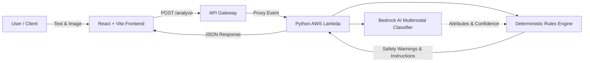

# 🌿 AI Waste Segregation Advisor (EcoSort AI)

> **Environmental Hacks Hackathon MVP**  
> Multimodal AI Waste Classification with Amazon Bedrock, Python Rules Engine, and AWS Lambda Serverless Architecture.

EcoSort AI helps individuals and facilities segregate waste accurately across four distinct streams—**Recyclable**, **Organic**, **Hazardous**, and **General**—while strictly preventing recycling contamination ("wishcycling") and neutralizing hazardous safety risks (such as lithium battery thermal runaway and chemical leaching).

---

## 🏗️ Architecture Overview



### Key Architectural Principles
1. **Decoupled AI & Rules Engine**: The AI model identifies the material, condition, and visual characteristics; a deterministic Python rules engine independently enforces environmental and safety laws.
2. **Strict Uncertainty Guard**: If confidence is below threshold (< 0.65) or the item is unknown/ambiguous, the engine **never invents confidence** and excludes the item from recyclable or compost streams to prevent contamination.
3. **Zero-Credential Mock Mode**: Complete local testing without AWS credentials or charges.
4. **Production Bedrock Ready**: Uses Amazon Bedrock Converse API / Claude 3 / Nova multimodal models with zero hardcoded credentials or secrets.

---

## 🗂️ Project Structure

```
ai-waste-segregation-advisor/
├── backend/
│   ├── ai_classifier.py          # Amazon Bedrock & MockClassifier integration
│   ├── rules_engine.py           # Deterministic Python disposal rules & safety checks
│   ├── lambda_handler.py         # AWS Lambda entrypoint for POST /analyze
│   ├── local_server.py           # Zero-dependency local dev server (port 5001)
│   ├── requirements.txt          # Python dependencies (boto3, pytest)
│   └── tests/
│       ├── test_rules_engine.py  # Tests rules, safety overrides, uncertainty
│       ├── test_ai_classifier.py # Tests mock & Bedrock classifiers
│       └── test_lambda_handler.py# Tests API Gateway contract & CORS
├── frontend/
│   ├── index.html                # Single-page HTML entrypoint
│   ├── package.json              # Node dependencies (React, Vite, Tailwind, Lucide)
│   ├── vite.config.js            # Vite configuration (port 3000)
│   ├── src/
│   │   ├── main.jsx              # React DOM mounting
│   │   ├── App.jsx               # Root state, error handling, stats
│   │   ├── components/
│   │   │   ├── Header.jsx        # Brand header & guide trigger
│   │   │   ├── WasteInputForm.jsx# Dual text & photo drag-and-drop input
│   │   │   ├── AnalysisResult.jsx# Structured disposal output & audit trail
│   │   │   ├── CategoryBadge.jsx # 4-stream color-coded badges
│   │   │   ├── SafetyAlert.jsx   # High-priority hazard warnings
│   │   │   ├── QuickPresets.jsx  # 1-click test items for hackathon judging
│   │   │   ├── CategoryGuideModal.jsx # Educational 4-stream modal
│   │   │   └── EnvironmentalStats.jsx # Real-time eco session counters
│   │   └── services/
│   │       ├── api.js            # POST /analyze HTTP client with error handling
│   │       └── mockData.js       # Curated presets & test cases
├── deployment/
│   ├── template.yaml             # AWS SAM (Serverless Application Model) template
│   ├── deploy-aws.sh             # Automated/guided AWS deployment script
│   └── iam-policy.json           # Least-privilege IAM policy for Bedrock & Logs
├── .gitignore
└── README.md
```

---

## 📦 API Contract: `POST /analyze`

### Request Schema
```json
{
  "text": "Clean aluminum soda can",
  "image": "data:image/jpeg;base64,...",
  "mock": false
}
```
*Note: At least one of `text` or `image` is required.*

### Success Response (200 OK)
```json
{
  "status": "success",
  "item_name": "Aluminum Beverage Can",
  "category": "recyclable",
  "is_uncertain": false,
  "confidence": 0.96,
  "confidence_level": "high",
  "summary": "'Aluminum Beverage Can' is a recyclable commodity. Proper preparation ensures high recovery rates.",
  "material": "Aluminum metal (#41 ALU)",
  "disposal_instructions": [
    "Empty all liquids completely.",
    "Rinse lightly to remove sticky residue.",
    "Place in your standard blue recycling bin (no need to crush unless saving space)."
  ],
  "safety_warnings": [],
  "preparation_steps": [
    "Empty contents completely",
    "Quick rinse"
  ],
  "alternative_options": [
    "Redeem at local container deposit depot for cash refund where available."
  ],
  "environmental_impact": "Recycling reduces virgin extraction of bauxite, petroleum, and timber while cutting industrial greenhouse gas emissions by up to 95%.",
  "rules_applied": [
    "Rule 6 [Clean Recyclable Rule]: Valid dry recyclable material verified.",
    "Sub-rule [Metal Recyclable]: Highly infinitely recyclable."
  ],
  "source": "bedrock"
}
```

### Uncertain Prediction Response (Safe Guardrail)
```json
{
  "status": "success",
  "item_name": "Unverified Item ('mystery substance')",
  "category": "general",
  "is_uncertain": true,
  "confidence": 0.48,
  "confidence_level": "low",
  "summary": "Item could not be definitively identified with high confidence (48%). To prevent contaminating recycling streams or compost batches, safe non-hazardous disposal is advised.",
  "material": "Indeterminate composite",
  "disposal_instructions": [
    "If the item is ordinary non-chemical household scrap, place it in the general/landfill bin.",
    "If there is any chance it contains batteries, wiring, or chemicals, treat it as hazardous waste.",
    "Check for manufacturer recycling codes before disposal."
  ],
  "safety_warnings": [
    "Uncertain identification: Placing unknown materials in recycling can contaminate entire processing batches (wishcycling).",
    "Do not incinerate or flush unknown items."
  ],
  "preparation_steps": [
    "Isolate from clean recyclables and food compost",
    "Inspect for manufacturer labels or hazard symbols"
  ],
  "rules_applied": [
    "Rule 1 [Uncertainty Guard]: Confidence (0.48) below threshold (0.65) or input ambiguous.",
    "Sub-rule: Excluded from recyclable and compostable streams to prevent batch contamination."
  ],
  "source": "mock"
}
```

---

## 🚀 Quickstart: Running Locally

### 1. Prerequisites
- **Python 3.10+** (Python 3.12 recommended)
- **Node.js 18+** & **npm**

### 2. Start the Backend Server
In a terminal window:
```bash
cd /home/mufeed/ai-waste-segregation-advisor

# 1. Activate virtual environment
source .venv/bin/activate

# 2. Run local development server (runs with mock fallback by default)
python -m backend.local_server
```
The backend starts at `http://localhost:5001`.  
You can test it with `curl http://localhost:5001/health`.

### 3. Start the Frontend Application
In a second terminal window:
```bash
cd /home/mufeed/ai-waste-segregation-advisor/frontend

# 1. Start Vite development server
npm run dev
```
Open **`http://localhost:3000`** in your browser.

---

## 🧪 Running Automated Tests

A comprehensive `pytest` test suite verifies the disposal rules engine, safety overrides, and API Gateway Lambda contracts:

```bash
cd /home/mufeed/ai-waste-segregation-advisor
source .venv/bin/activate

pytest backend/tests/ -v
```

### What is tested:
- ✅ Recyclable stream validation (aluminum cans, glass bottles, rigid plastics)
- ✅ Organic compost validation (food scraps, produce sticker removal steps)
- ✅ Hazardous safety overrides (lithium batteries, fluorescent CFL mercury, motor oil, medical sharps)
- ✅ Food contamination guard (greasy pizza box portioning)
- ✅ Uncertain / low-confidence fallback (safeguards against wishcycling)
- ✅ Material disqualifiers (styrofoam exclusion from single-stream)
- ✅ API Gateway CORS preflight and error status codes

---

## ☁️ AWS Configuration & Amazon Bedrock Setup

When you are ready to use real Amazon Bedrock multimodal AI:

### 1. Enable Bedrock Model Access
1. Open the **AWS Management Console** and navigate to **Amazon Bedrock**.
2. Select your target region (e.g., `us-east-1` or `us-west-2`).
3. Click on **Model access** in the left sidebar.
4. Click **Modify model access** and request access for:
   - **Anthropic Claude 3 Haiku** (`anthropic.claude-3-haiku-20240307-v1:0`)
   - OR **Amazon Nova Lite** (`amazon.nova-lite-v1:0`)

### 2. Configure AWS Credentials
Run in your shell:
```bash
aws configure
# Enter your AWS Access Key ID, Secret Access Key, and Region (e.g. us-east-1)
```
*Note: The code NEVER hardcodes credentials. It relies on standard AWS credential provider chains (environment variables, IAM roles, or AWS profile).*

### 3. Test Bedrock Locally
Set `MOCK_MODE=false` before running the local server:
```bash
export AWS_REGION="us-east-1"
export BEDROCK_MODEL_ID="anthropic.claude-3-haiku-20240307-v1:0"
export MOCK_MODE="false"

python -m backend.local_server
```

---

## 🚢 AWS Serverless Deployment

### Option A: Deploy with AWS SAM (Recommended)
```bash
cd /home/mufeed/ai-waste-segregation-advisor/deployment
sam build -t template.yaml
sam deploy --guided
```
SAM creates:
- The AWS Lambda function (`python3.12`, 512MB, with Bedrock IAM policy)
- The HTTP API Gateway with CORS enabled
- Outputs the live URL (e.g., `https://<api-id>.execute-api.us-east-1.amazonaws.com/analyze`)

### Option B: Deploy with the Automated Script
```bash
cd /home/mufeed/ai-waste-segregation-advisor
./deployment/deploy-aws.sh
```

### Option C: Frontend Hosting
Build the static assets:
```bash
cd /home/mufeed/ai-waste-segregation-advisor/frontend
npm run build
```
Upload the contents of `dist/` to **AWS S3 + CloudFront**, **Vercel**, or **AWS Amplify**.

---

## 🏆 Hackathon Demo Features
- **1-Click Preset Buttons**: Instantly test all 4 categories, contaminated items, and uncertain inputs without typing.
- **Multimodal Visual Inspection**: Drag and drop real waste photos for visual classification.
- **Rules Engine Audit Trail**: Click "Rules Engine Audit Trail" on any result to inspect the exact environmental logic applied.
- **Mock Mode Switch**: Live toggle between mock simulation and Amazon Bedrock in the UI header.
